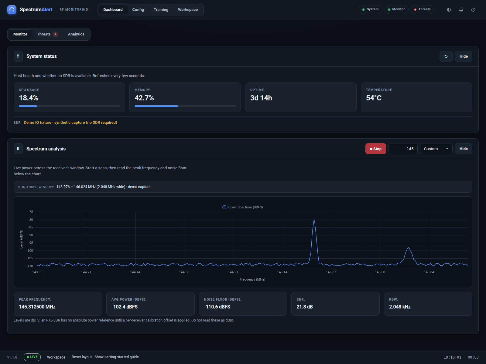
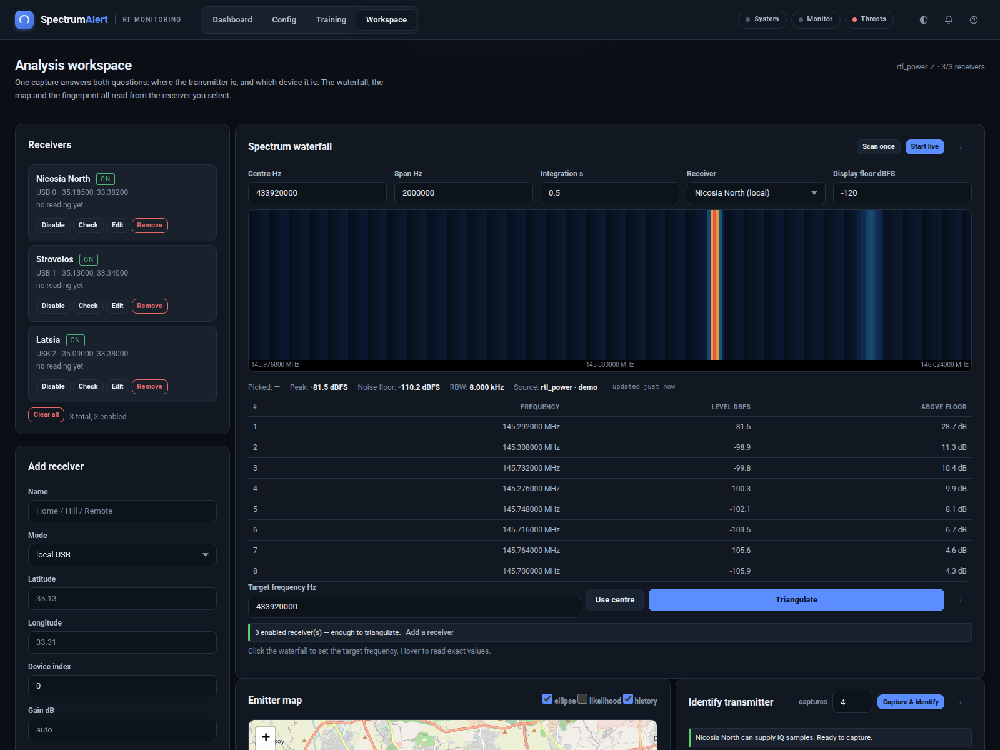
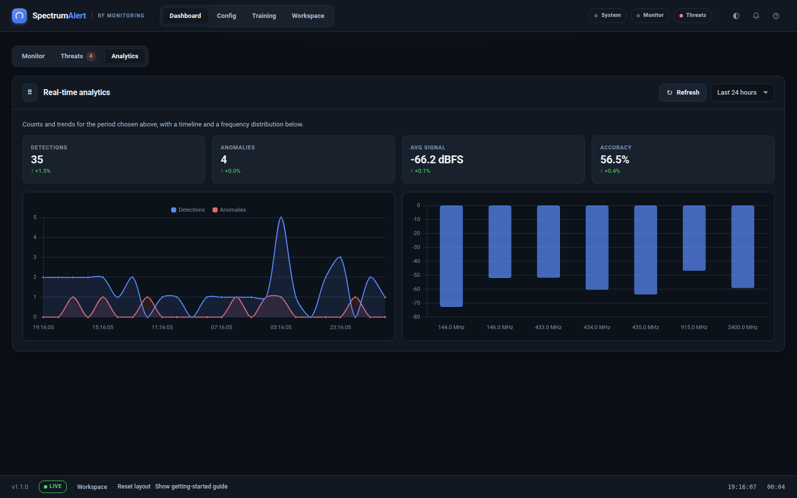
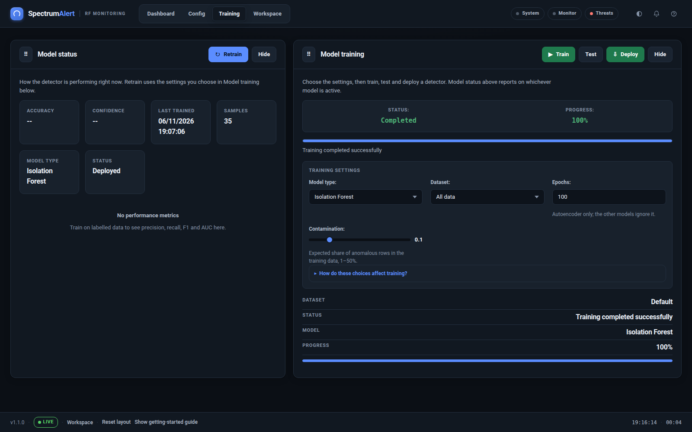
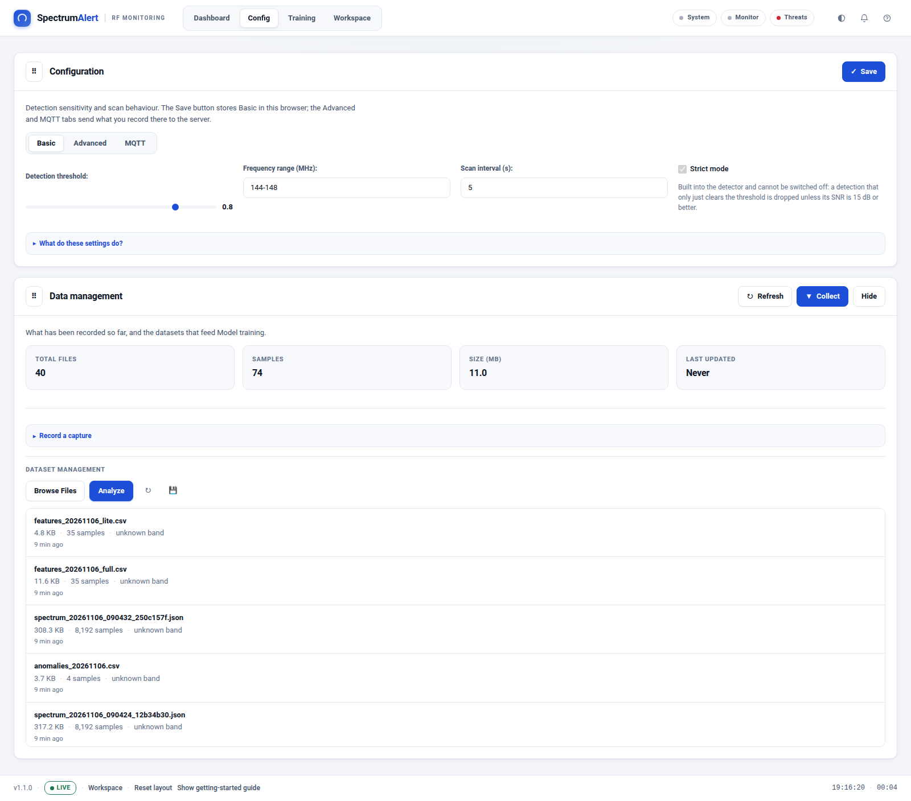
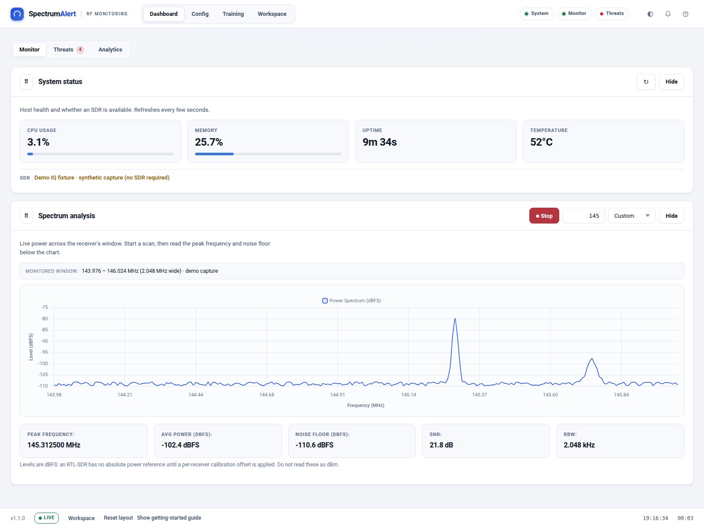
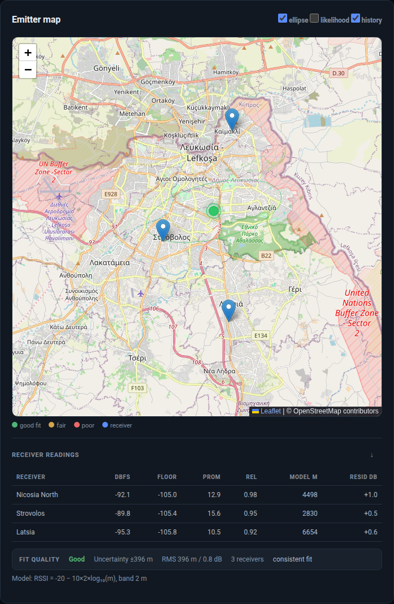

# SpectrumAlert

**RF spectrum monitoring, anomaly detection, transmitter geolocation and device identification — from one receiver to a multi-receiver deployment.**




SpectrumAlert turns an RTL-SDR (or several) into an operator console for RF work: live
spectrum and waterfall views, SNR-based threat detection, multi-receiver
triangulation, calibration, RF fingerprinting and model training. It runs as a
web dashboard, as a terminal application, or as a headless service.

---

## Contents

- [Why SpectrumAlert](#why-spectrumalert)
- [Web UI or CLI?](#web-ui-or-cli)
- [Quick start](#quick-start)
- [Screenshots](#screenshots)
- [Features](#features)
- [CLI reference](#cli-reference)
- [Docker](#docker)
- [Demo IQ data and tests](#demo-iq-data-and-tests)
- [Data and signal levels](#data-and-signal-levels)
- [Architecture](#architecture)
- [Documentation](#documentation)
- [License](#license)

---

## Why SpectrumAlert

- **One capture, several answers.** The analysis workspace locates an emitter,
  names the device type against a reference library, and keeps the capture that
  produced both.
- **Designed for real receivers.** Device-level locking prevents two processes
  from fighting over one dongle; RTL-SDR, remote `rtl_tcp` and manual-level
  receivers share one interface.
- **Honest measurements.** Levels are reported as dBFS, not dBm, until a
  per-receiver calibration is applied. DC and passband-edge artefacts are
  excluded before detection.
- **Runs offline.** Bootstrap and the dashboard assets are vendored. The UI does
  not need a CDN or internet connection.
- **No dongle required for development.** The included IQ fixture generator
  exercises storage, features, detection, training and the dashboard with
  deterministic synthetic captures.

---

## Web UI or CLI?

**Both work. The GUI does not replace the terminal.**

The dashboard and CLI share the same backend, detector, configuration and data
directory. You can collect data from the CLI and review it in the dashboard, or
start monitoring in the dashboard and inspect the same sessions from the
terminal.

| Task | Web dashboard | Terminal |
| --- | --- | --- |
| Start the dashboard | `spectrum-alert web --port 8000` | — |
| Check receiver / system state | Dashboard → **System status** | `spectrum-alert monitor status` |
| Start a live scan | Dashboard → **Spectrum analysis → Start** | `spectrum-alert monitor start --freq-start 144 --freq-end 148` |
| Review anomalies | **Threats** module | `spectrum-alert monitor status` |
| Manage receivers | **Workspace → Receivers** | `spectrum-alert geo receivers` |
| Triangulate a transmitter | **Workspace → Triangulate** | `spectrum-alert geo triangulate 446100000` |
| Train a model | **Training → Train** | Use the dashboard training workflow |
| Docker dashboard | `docker compose up -d` | — |
| Docker CLI command | — | `docker compose run --rm spectrumalert monitor status` |

**One dongle, one owner at a time.** A physical RTL-SDR can only be opened by one
process. Stop dashboard monitoring before running a CLI scan against the same
device.

---

## Quick start

### Requirements

- Python 3.8+
- An RTL-SDR dongle (optional for the demo dataset and UI work)
- Linux is recommended; macOS/Windows require appropriate USB drivers

### Install and run locally

```bash
git clone https://github.com/Slayingripper/SpectrumAlert.git
cd SpectrumAlert
python3 -m venv .venv
source .venv/bin/activate
pip install -e .
```

Start the dashboard:

```bash
spectrum-alert web --host 0.0.0.0 --port 8000
```

Open <http://localhost:8000>.

Check that the backend and receiver are visible:

```bash
spectrum-alert monitor status
spectrum-alert geo receivers
```

### Run with Docker

```bash
docker compose up -d
```

Open <http://localhost:8088>. The container listens on port 8000 internally; the
host port is configurable:

```bash
SPECTRUM_ALERT_WEB_PORT=9000 docker compose up -d
```

For CLI commands in the same container setup:

```bash
docker compose run --rm spectrumalert monitor status
```

The default compose service is the dashboard. The `service` and `autonomous`
profiles run headless monitoring:

```bash
docker compose --profile service up spectrumalert-service
docker compose --profile autonomous up spectrumalert-autonomous
```

---

## Screenshots

Captured from the bundled synthetic demo dataset
(`scripts/generate_iq_samples.py`).

| Dashboard | Analysis workspace |
| --- | --- |
|  |  |
| **Real-time analytics** | **Model training** |
|  |  |
| **Configuration and data management** | **Light theme** |
|  |  |

The screenshots use a synthetic IQ source so they can be reproduced without a
physical dongle. The interface, storage format and detection pipeline are the
same as a live receiver.

### Triangulation



Each enabled receiver contributes an RSSI reading. The path-loss model converts
those readings into distance circles; the solver finds the position that fits
all circles best under a Huber loss, so one multipath-faded receiver cannot drag
the fix away.

The screenshot shows a three-receiver fix with:

- Blue pins for the receivers
- A green emitter marker and confidence circle
- A **good** fit-quality result
- Modelled distances and signed residuals for every receiver
- The exact path-loss model used for the solve

Triangulation needs at least two receivers with coordinates; three or more are
needed for a meaningful fix. See the
[triangulation guide](docs/wiki/Triangulation.md) for requirements and output
fields.

---

## Features

### Detection and analysis

- Hann-windowed periodogram with percentile noise-floor estimation
- SNR, prominence and local-neighbour gating
- DC and passband-edge artefact rejection
- Novelty suppression for stable carriers
- Sub-bin peak interpolation for precise frequency reporting
- Lite (2-feature) and Full (12-feature) detection modes
- Severity grading from **low** through **critical**

### Geolocation and identification

- Multi-receiver RSSI triangulation with confidence ellipse
- Path-loss model with Huber-robust weighted least squares
- Fit-quality grading with the reasons surfaced in the UI
- Per-receiver, per-frequency calibration offsets
- PMR446 channel scanner
- Gain-invariant RF fingerprinting with a reference library
- Explicit **identified**, **ambiguous**, **indeterminate**, **no-match** and
  **unknown** outcomes

### Operations

- Receiver roster for local USB and remote `rtl_tcp` receivers
- Per-device and cross-process locking
- Atomic, schema-versioned storage
- MQTT publishing for anomalies and status
- WebSocket live updates
- Dark and light themes
- Guided first-run workflow
- Model training, testing and deployment from the dashboard

---

## CLI reference

The console entry point is:

```bash
spectrum-alert --help
```

### Monitoring

```bash
# System and receiver state
spectrum-alert monitor status

# Start a scan
spectrum-alert monitor start --freq-start 144 --freq-end 148 --mode full

# Timed scan
spectrum-alert monitor start --freq-start 430 --freq-end 440 --duration 300

# Tune the detector
spectrum-alert monitor start --freq-start 144 --freq-end 148 \
  --threshold 0.8 --strict-threshold \
  --dc-exclude-hz 8000 --edge-exclude-hz 20000 \
  --novelty --novelty-cooldown-s 5
```

### Autonomous operation

```bash
# Continuous single-band operation
spectrum-alert monitor autonomous --freq-start 144 --freq-end 148 \
  --continuous-learning

# Rotate across bands
spectrum-alert monitor autonomous-multiband \
  -b 144-148 -b 430-440 \
  --data-minutes 5 --monitor-minutes 15
```

### Geolocation

```bash
spectrum-alert geo receivers
spectrum-alert geo scan 446100000 --span 200000 -i 0.5
spectrum-alert geo triangulate 446100000
spectrum-alert geo calibrate
spectrum-alert geo calibrate --apply
spectrum-alert geo fit-ple
```

Add receivers:

```bash
spectrum-alert geo add-receiver Home --lat 35.130 --lon 33.310 --gain 30 --ppm 20
spectrum-alert geo add-receiver Hill --lat 35.080 --lon 33.380 \
  --mode rtltcp --host 10.0.0.5 --port 1234
```

### Web, system and configuration

```bash
spectrum-alert web --host 0.0.0.0 --port 8000
spectrum-alert system status
spectrum-alert config --help
spectrum-alert version
```

See the [CLI reference](docs/wiki/CLI-Reference.md) for the full option set.

---

## Docker

The image runs as a non-root `spectrum` user and uses `devices:` plus
`group_add: plugdev` for USB access. It does not require privileged mode.

```bash
# Dashboard
docker compose up -d

# CLI one-shot
docker compose run --rm spectrumalert monitor status

# Headless service / autonomous monitoring
docker compose --profile service up spectrumalert-service
docker compose --profile autonomous up spectrumalert-autonomous
```

Persistent data is mounted from the checkout:

```text
data/       captures, feature CSVs and anomaly history
models/     trained model artifacts
logs/       application logs
config/     configuration files
```

See the [Docker guide](docs/wiki/Docker.md) for the full reference.

---

## Demo IQ data and tests

`scripts/generate_iq_samples.py` produces deterministic captures with raw IQ,
stored spectrum data, full/lite feature rows and anomaly records.

```bash
# Generate a self-contained demo tree
python scripts/generate_iq_samples.py \
  --data-dir /tmp/spectrumalert-demo/data \
  --raw-dir  /tmp/spectrumalert-demo/raw

# Run the test suite
pytest
```

The default fixture set contains 30 clean captures, one CW signal, two-tone,
FSK, ASK and a wideband negative control. The script exits non-zero if a signal
is missed or a clean capture raises an alert.

The same generator can be run inside the container:

```bash
docker compose run --rm --no-deps --entrypoint python spectrumalert \
  scripts/generate_iq_samples.py --data-dir /tmp/iq/data --raw-dir /tmp/iq/raw
```

---

## Data and signal levels

Everything the RTL-SDR reports is **dBFS** (relative to full scale), not dBm.
There is no absolute power reference until a per-receiver calibration offset is
applied, and even after calibration the result is only as good as that
calibration.

Data lives under `data/`:

```text
data/spectrum/    atomic JSON captures with I/Q samples and metadata
data/features/    feature CSVs used by model training
data/anomalies/   daily anomaly history
data/logs/        runtime logs
data/receivers.json
```

Spectrum files are versioned and the reader also accepts the legacy
`samples_real` / `samples_imag` schema.

---

## Architecture

```text
spectrum_alert/
├── cli/              Typer CLI, including geo commands
├── core/
│   ├── domain/       Pydantic models
│   ├── interfaces/   Ports / protocols
│   └── services/     detection, spectrum analysis, calibration,
│                     triangulation, fingerprinting, propagation
├── infrastructure/
│   ├── sdr/          RTL-SDR, rtl_tcp, scanner, device locks
│   ├── storage/      atomic data and receiver stores
│   ├── messaging/    MQTT
│   └── monitoring/   host metrics
├── application/      use cases and workflows
└── web/              FastAPI app, geolocation API, dashboard assets
```

Key design rules:

- Domain code has no infrastructure imports.
- A dongle is serialised by an in-process lock and an advisory file lock.
- Storage writes are atomic and versioned.
- The dashboard and CLI share one detector and one data directory.
- The UI is served from packaged assets and works offline.

---

## Documentation

The full documentation is published in the
[GitHub Wiki](https://github.com/Slayingripper/SpectrumAlert/wiki):

- [Home](https://github.com/Slayingripper/SpectrumAlert/wiki)
- [Installation](https://github.com/Slayingripper/SpectrumAlert/wiki/Installation)
- [Quick Start](https://github.com/Slayingripper/SpectrumAlert/wiki/Quick-Start)
- [Web Dashboard](https://github.com/Slayingripper/SpectrumAlert/wiki/Web-Dashboard)
- [Triangulation](https://github.com/Slayingripper/SpectrumAlert/wiki/Triangulation)
- [CLI Reference](https://github.com/Slayingripper/SpectrumAlert/wiki/CLI-Reference)
- [Docker](https://github.com/Slayingripper/SpectrumAlert/wiki/Docker)
- [Configuration](https://github.com/Slayingripper/SpectrumAlert/wiki/Configuration)
- [Data and Training](https://github.com/Slayingripper/SpectrumAlert/wiki/Data-and-Training)
- [Troubleshooting](https://github.com/Slayingripper/SpectrumAlert/wiki/Troubleshooting)
- [FAQ](https://github.com/Slayingripper/SpectrumAlert/wiki/FAQ)

Source copies of the wiki pages are kept under [`docs/wiki/`](docs/wiki/).
Configuration file reference: [`docs/configuration.md`](docs/configuration.md).

---

## License

MIT. See [LICENSE](LICENSE).
