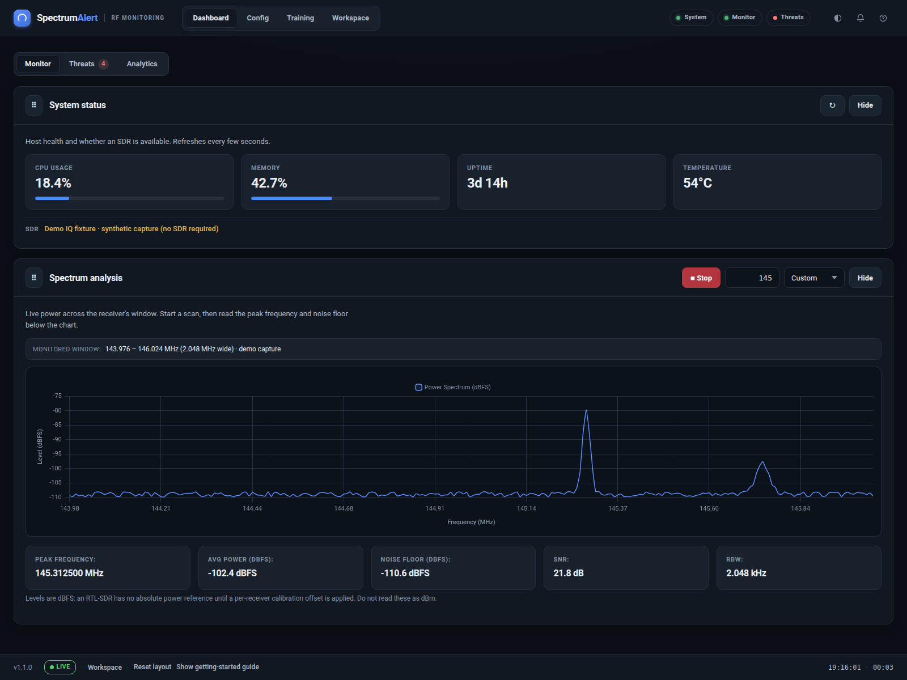

# SpectrumAlert Wiki

**RF spectrum monitoring, anomaly detection, transmitter geolocation and device identification.**



SpectrumAlert is an operator console for RTL-SDR receivers. It provides a web
dashboard, a terminal interface, headless services and a Docker deployment. All
interfaces share one detector, one storage format and one data directory.

## Start here

| Page | Purpose |
| --- | --- |
| [Installation](Installation.md) | Local install, SDR permissions, Docker |
| [Quick Start](Quick-Start.md) | First dashboard session and first scan |
| [Web Dashboard](Web-Dashboard.md) | Modules, workflow and screenshots |
| [CLI Reference](CLI-Reference.md) | Terminal commands and options |
| [Docker](Docker.md) | Compose services, USB access, ports |
| [Data and Training](Data-and-Training.md) | Capture storage, IQ fixtures, model training |
| [Troubleshooting](Troubleshooting.md) | Receiver, port and USB problems |
| [FAQ](FAQ.md) | GUI vs CLI, dBFS, ports, common questions |

## At a glance

- Live spectrum, waterfall and detection timeline
- SNR and prominence based anomaly detection
- Multi-receiver triangulation with confidence grading
- Per-receiver calibration and path-loss fitting
- RF fingerprinting with a reference library
- Remote `rtl_tcp` receivers
- PMR446 channel scanner
- Model training, testing and deployment
- Dark and light themes, responsive layout
- Offline-capable UI assets
- Deterministic synthetic IQ fixtures for development

## GUI and CLI are both supported

The web dashboard is not a replacement for the terminal. It is another front end
to the same backend:

```bash
# Terminal
spectrum-alert monitor status
spectrum-alert monitor start --freq-start 144 --freq-end 148

# Web dashboard
spectrum-alert web --port 8000

# Docker dashboard
docker compose up -d

# Docker CLI command
docker compose run --rm spectrumalert monitor status
```

Only one process can hold a physical RTL-SDR at a time. Stop dashboard
monitoring before running a CLI scan against the same dongle.

## Signal levels

Levels are **dBFS**, not dBm. The RTL-SDR has no absolute power reference until a
per-receiver calibration offset is applied. See
[Data and Training](Data-and-Training.md) for the storage model.
