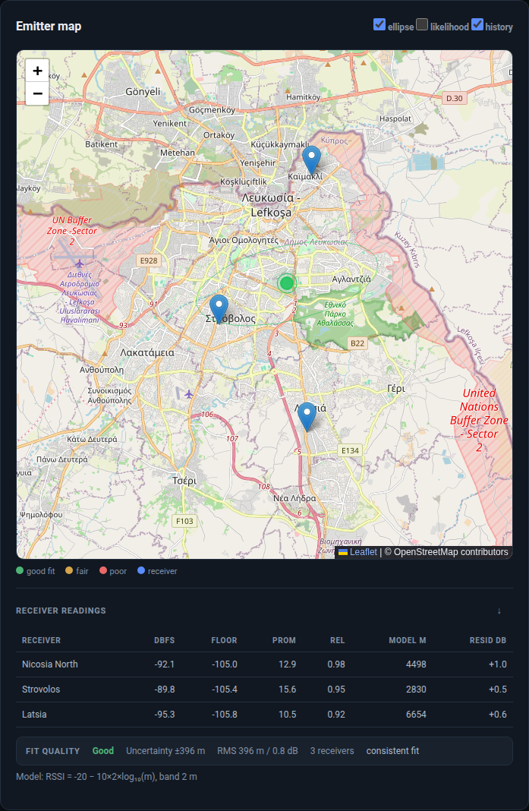

# Triangulation

Triangulation estimates where a transmitter is from the signal levels measured by
several receivers.



## How the fix is produced

1. Every enabled receiver measures the target frequency.
2. The log-distance path-loss model converts RSSI to a distance:
   `d = 10 ^ ((P0 - RSSI) / (10 * n))`
3. Each receiver therefore defines a distance circle around its position.
4. The solver finds the point that minimises the weighted Huber loss across all
   circles.
5. A numerical Hessian produces the confidence ellipse and the reported
   uncertainty.

Huber loss is used instead of plain least squares because RSSI varies with
multipath. A single faded receiver can move a least-squares fix by kilometres;
Huber limits that influence.

## Requirements

- At least **two** enabled receivers with coordinates
- **Three or more** for a meaningful fix; two are underconstrained and the UI
  reports that explicitly
- A measured signal at the target frequency. Weak readings are labelled and
  excluded or used as a low-confidence fallback

Add receivers from the dashboard or CLI:

```bash
spectrum-alert geo add-receiver Home --lat 35.130 --lon 33.310 --gain 30 --ppm 20
spectrum-alert geo add-receiver Hill --lat 35.080 --lon 33.380 \
  --mode rtltcp --host 10.0.0.5 --port 1234
spectrum-alert geo receivers
```

## Using the workspace

1. Open **Workspace**.
2. Select the target frequency or click the waterfall.
3. Press **Triangulate**.
4. Read the map and the receiver readings table.

The map shows:

| Layer | Meaning |
| --- | --- |
| Blue pins | Receivers with coordinates |
| Green/amber/red marker | Estimated emitter, coloured by fit quality |
| Filled circle | Reported uncertainty radius |
| Ellipse | Confidence region |
| History | Previous fixes, if enabled |

The readings table reports:

| Column | Meaning |
| --- | --- |
| dBFS | Measured level at the target |
| Floor | Local noise floor |
| Prom | Prominence above the floor |
| Rel | Measurement reliability |
| Model m | Distance implied by the RSSI model |
| Resid dB | Measured minus predicted level |

## Fit quality

Quality is graded **good**, **fair** or **poor** from:

- RMS RSSI residual
- RMS distance residual
- Receiver geometry and spread
- Confidence-ellipse size
- Outlier behaviour across receivers

The quality reasons are returned with the fix and available in the map popup
instead of being reduced to a colour.

## CLI

```bash
# Scan one frequency from every enabled receiver
spectrum-alert geo triangulate 446100000

# Calibrate receivers against known transmitters before locating
spectrum-alert geo calibrate
spectrum-alert geo calibrate --apply

# Fit the path-loss exponent to the local environment
spectrum-alert geo fit-ple
```

The web API exposes the same operation:

```bash
curl -X POST localhost:8000/api/triangulate \
  -H 'Content-Type: application/json' \
  -d '{"frequencyHz": 145312500, "windowHz": 12000, "integrationSec": 0.5}'
```

You can also send readings measured elsewhere:

```bash
curl -X POST localhost:8000/api/triangulate/readings \
  -H 'Content-Type: application/json' \
  -d '{
    "frequencyHz": 145312500,
    "readings": [
      {"id":"north","name":"North","lat":35.185,"lon":33.382,"rssiDbm":-92.1},
      {"id":"central","name":"Central","lat":35.130,"lon":33.340,"rssiDbm":-89.8},
      {"id":"south","name":"South","lat":35.090,"lon":33.380,"rssiDbm":-95.3}
    ]
  }'
```

## Improving accuracy

- Calibrate every receiver against a known transmitter.
- Use three or more receivers with good angular spread; collinear receivers
  produce a long, uncertain ellipse.
- Avoid placing all receivers at similar distances from the target.
- Fit the path-loss exponent for the local environment.
- Treat a fix with a large residual or a high `Resid dB` on one receiver as
  suspect.

## Signal levels

Readings are dBFS. Calibration offsets convert relative levels to a consistent
scale across receivers; without calibration, receiver gain differences are
indistinguishable from distance differences.

## Related

- [Web Dashboard](Web-Dashboard.md)
- [Data and Training](Data-and-Training.md)
- [CLI Reference](CLI-Reference.md)
- [FAQ](FAQ.md)
