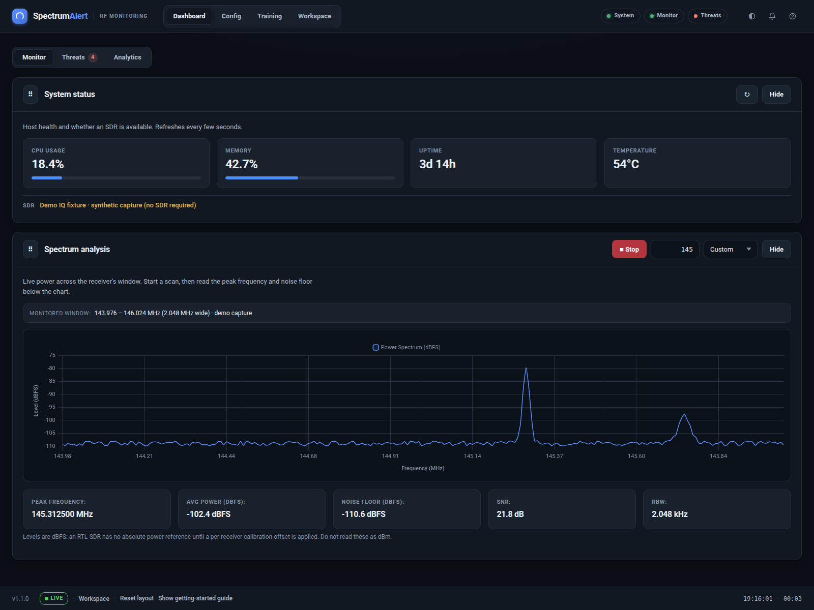
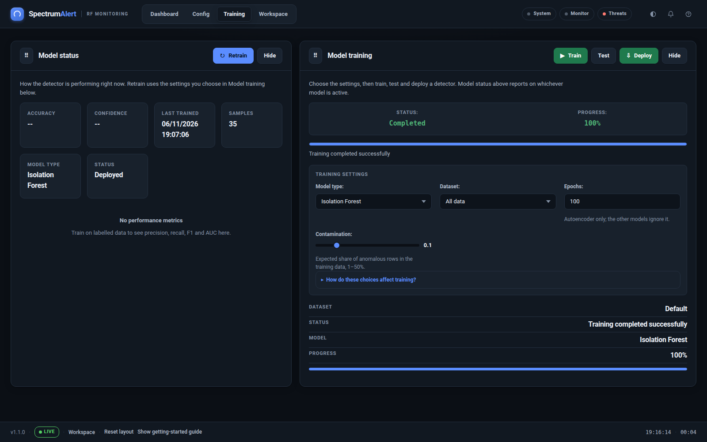
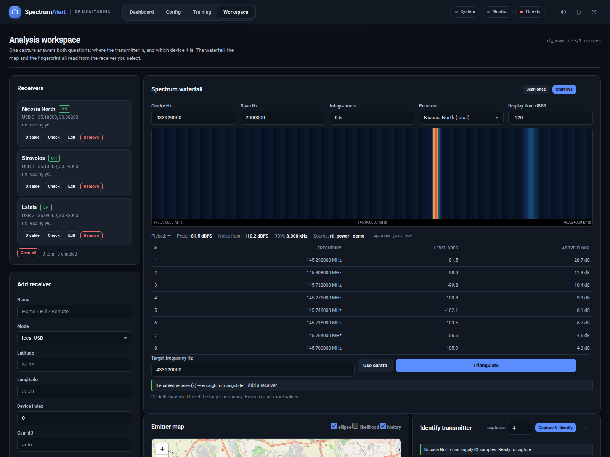

# Web Dashboard

The dashboard is a FastAPI application with a vanilla JavaScript front end. It
uses the same storage and detector as the CLI.

## Navigation

| Section | Purpose |
| --- | --- |
| **Dashboard** | Monitor, threats and analytics modules |
| **Config** | Detector settings and data management |
| **Training** | Model status, training, testing and deployment |
| **Workspace** | Receivers, waterfall, map, fingerprinting and PMR446 |

### Dashboard modules

- **Monitor** — host status and live spectrum
- **Threats** — severity counters, detection timeline and recent alerts
- **Analytics** — counts, trends and frequency distribution

### Config

The Basic tab stores detection sensitivity in the browser. Advanced and MQTT
tabs record settings with the server. Data Management lists feature, anomaly and
spectrum files and links them to model training.

### Training

Training reads feature CSVs for the chosen mode. **All data** uses every feature
file; **Recent** uses the last 24 hours. A model needs at least ten usable rows.

After training, the model status panel and training status update automatically.

### Workspace

The workspace is one screen because location and identity come from the same
capture. The receiver roster and target frequency stay fixed while the analysis
below changes.

Key requirements:

- At least two enabled receivers for triangulation
- Coordinates for every receiver used in a fix
- A receiver with IQ access for fingerprinting
- Most receivers reporting a PMR446 channel at least 20 dB above their own noise
  floor before a channel counts as active

## Screens and states

The UI distinguishes:

- **Loading** — request in flight
- **Empty** — request succeeded, no data
- **Stale** — last successful data is still shown with an age
- **Error** — request failed, with a retry action where possible

The dashboard never fabricates spectrum data. If the backend returns no trace,
the chart shows an empty state instead of a synthetic signal.

## Themes and accessibility

- Dark and light themes, remembered per browser
- Theme toggle in the app bar; keyboard shortcut `T`
- Visible focus rings and skip-to-content link
- Severity is carried by text and shape, not colour alone
- Responsive layout down to phone widths
- The waterfall and charts expose text alternatives

## Keyboard shortcuts

Press `?` in the dashboard to open the full shortcut sheet. Common entries:

| Key | Action |
| --- | --- |
| `S` | Start / stop monitoring |
| `T` | Toggle theme |
| `M` | Mute notifications |
| `E` | Export alerts |
| `J` | Jump to the workspace |
| `Esc` | Close dialogs |

## Related

- [CLI Reference](CLI-Reference.md)
- [Docker](Docker.md)
- [Troubleshooting](Troubleshooting.md)
